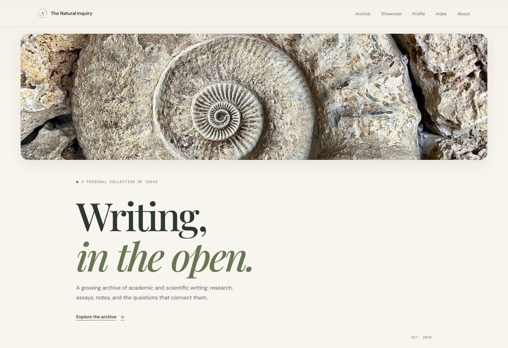

# The Natural Inquiry

A personal archive of academic and scientific writing by Chloe Elia: essays, research projects, and a browsable index of the natural sciences.

**Live site:** https://chloeroseelia.github.io/The-Natural-Inquiry/

The public site is plain HTML, CSS, and JavaScript. There is no build step: what's in the repository is what GitHub Pages serves.



## What's on the site

| Page | File | What it is |
|---|---|---|
| Home | `index.html` | Introduction, links to the other sections, and a searchable, filterable writing archive |
| Academic profile | `profile.html` | Biography, background, research experience, and CV download |
| Research & Writing Showcase | `writing-showcase.html` | Current research in a swipeable carousel, plus featured writing |
| The Natural Inquiry Index | `natural-inquiry-index.html` | A directory of scientific disciplines and subjects, linked to related writing |
| Research Interest Map | `interests.html` | An interactive interest map. **Not currently linked from any page** |
| Writing pages | `writing/*.html` | One reading page per essay |
| Research pages | `research/*.html` | One page per research project |

## Project layout

```
index.html, profile.html, ...     Top-level pages
styles.css                        All site styling
script.js                         Homepage archive: search, filters, listing
natural-inquiry-index-data.js     Content data: archive entries, Index categories and subjects
natural-inquiry-index.js          Index page interactions
natural-inquiry-subject-links.js  Shows category/subject links at the top of writing pages
research-carousel.js              Showcase carousel
interests.js                      Interest map data and interactions
writing/                          Essay pages (template.html is the starting point)
research/                         Research project pages
images/                           Banners, portrait, and the social share image
favicon.svg                       Browser tab icon
*.pdf                             CV and original PDFs of published essays
```

## Adding a new piece of writing

1. **Create the page.** Copy `writing/template.html` to a new file such as `writing/field-notes.html`.
2. **Fill it in.** Replace every `[bracketed prompt]` with the title, summary, publication details, text, and references. In the `<head>`, update the `<title>`, the description, and the matching `og:title` / `og:description` share tags. Add `canonical` and `og:url` tags pointing to the page's live address (copy them from any existing writing page).
3. **Set the page's URL.** Change `data-writing-url` on the page to its site-relative path, e.g. `writing/field-notes.html`.
4. **Add it to the archive.** Add an entry to the `naturalInquiryWritings` array in `natural-inquiry-index-data.js`:

   ```js
   {
     title: "Field Notes",
     type: "Essay",            // Essay, Research, or Notes
     year: 2026,               // optional, but recommended
     description: "One or two sentences about the piece.",
     url: "writing/field-notes.html"
   }
   ```

5. **Connect it to the Index (optional).** In the same file, add the page's URL to the relevant category's `relatedWriting` array, and to a subject's list in `subjectWriting`. The Index will then list the piece, and the piece will show its category and subjects above the text.
6. **Preview it** (see below) before publishing.

An archive entry can also link straight to a PDF or an external publication instead of a page on this site.

### Adding a banner image to a writing page

Banners are optional. In your copied page, uncomment the `<figure class="article-hero">` block, put the image in `images/`, and fill in the path, alt text (a description for readers who can't see the image), and an optional caption or credit.

## Adding a research project

Research projects appear in three places, each edited by hand:

1. **The project page.** Copy an existing page in `research/` (for example `research/garibaldi.html`) to a new file. Replace the text, and update the `<title>`, description, share tags, `canonical`, and `og:url` in the `<head>`.
2. **The Showcase carousel.** In `writing-showcase.html`, copy one `<article class="research-carousel-slide">` block, point its link at the new page, and update its label and summary. Then:
   - update every slide's `aria-label` count (`"1 of 5"`, `"2 of 5"`, …);
   - add a matching `<button ... data-carousel-dot="N">` for the new slide, numbered from 0.
3. **The profile.** Link the project from the Research experience section of `profile.html`.

## Updating the profile and CV

- **Profile text:** edit the sections in `profile.html` directly.
- **CV:** replace `Chloe Elia - CV.pdf` with the new PDF, keeping the same filename. If you rename it, update the CV download link in `profile.html` to match.
- **Portrait:** replace `images/chloe-elia.jpg` (portrait orientation, about 900 px wide), and update its `width`, `height`, and alt text in `profile.html` if they change.

## Images

- Keep photos around **1800–2000 px wide** and under **~500 KB**. Use JPG for photos; PNG only when the image needs transparency.
- Always set `width` and `height` on `` to the image's real pixel size. This stops the page from jumping while it loads.
- Write meaningful `alt` text for every image.
- `images/og-image.jpg` (1200 × 630) is the preview image shown when a link to the site is shared on social media or in messages. Replace it to change that preview.

## Preview locally

Open `index.html` in a browser. No install or build is needed.

## Publishing

GitHub Pages publishes the `main` branch from the repository root. Pushing to `main` updates the live site, usually within a minute or two.

## Editorial dashboard (in development)

A separate React dashboard and AWS Amplify backend, for drafting and publishing content without editing files by hand, are being developed on the `admin-dashboard` branch in the `admin/` and `amplify/` folders. They are not part of the public site. Setup and current status are in `admin/README.md` on that branch.

## Content still to finish

- `writing/birds-as-neighbors.html` is a **hypothetical sample essay** used for the design, not real work. Replace or remove it.
- The research pages `garibaldi.html`, `migratory-birds.html`, and `pacific-trade-winds.html` are short **mockups** awaiting full project details.
- In `natural-inquiry-index-data.js`, "The Choice to Sail Away" and "Seaweed Made Simple" have no `year`, and "The Choice to Sail Away" needs a real description.

## Copyright

The writing, research, and images on this site are © Chloe Elia. All rights reserved.
